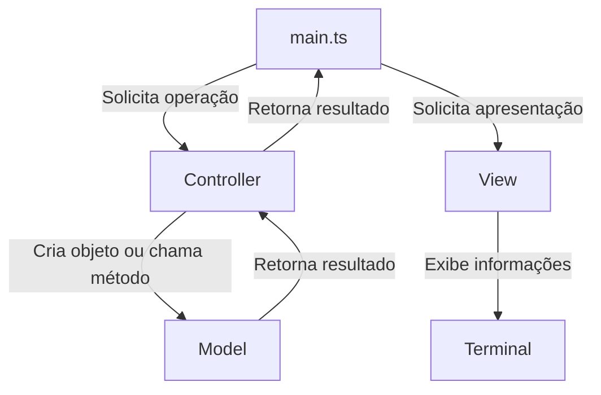
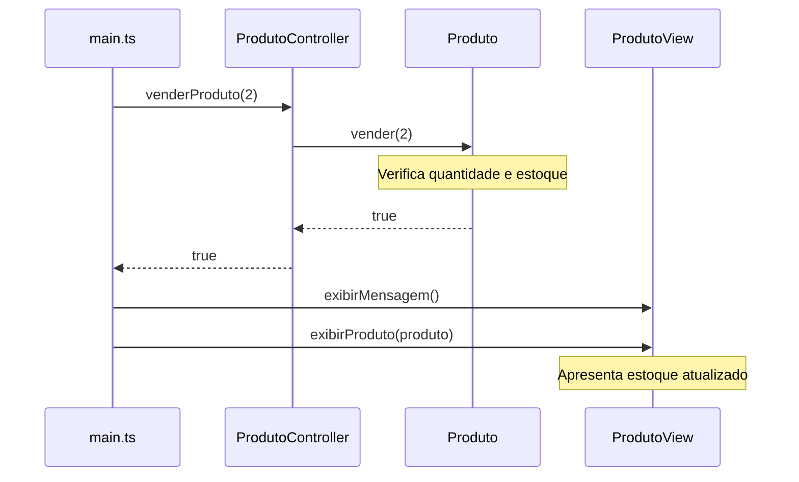

# 🧩 Aula: Organizando projetos TypeScript com MVC

**Professor: Éder Silva**

**Pré-requisitos:** TypeScript, classes, objetos, construtores, métodos, encapsulamento, import e export.

**Ambiente:** Visual Studio Code, Node.js e TypeScript.

## 1. O que vamos aprender hoje?

Até aqui, nós aprendemos a criar classes, instanciar objetos e implementar métodos em TypeScript. Agora vamos descobrir juntos como podemos organizar esses conhecimentos em um projeto que seja mais fácil de entender, manter e ampliar.

Não vamos aprender uma nova linguagem. Vamos continuar utilizando TypeScript, mas distribuiremos o código de acordo com a responsabilidade de cada parte do sistema.

Ao final desta aula, nosso objetivo é conseguir identificar as três camadas do MVC, separar as classes em arquivos e construir uma pequena aplicação que servirá de preparação para o nosso projeto PetShopVet4Patas.

## 2. Por que precisamos organizar o código?

Vamos imaginar que tenhamos criado um sistema de cadastro de produtos. Inicialmente, podemos escrever tudo em um único arquivo:

```typescript
class Produto {
    constructor(
        public nome: string,
        public preco: number,
        public estoque: number
    ) {}

    calcularTotal(): number {
        return this.preco * this.estoque;
    }
}

const produto = new Produto("Teclado", 150, 5);

if (produto.preco > 0 && produto.estoque >= 0) {
    console.log("Produto: " + produto.nome);
    console.log("Valor total: R$ " + produto.calcularTotal());
} else {
    console.log("Dados inválidos.");
}
```

Esse código funciona. Para um exemplo pequeno, não existe problema em utilizar um único arquivo. Mas vamos imaginar que precisemos acrescentar clientes, fornecedores, vendas, pagamentos e relatórios.

Se continuarmos concentrando tudo no mesmo arquivo, será cada vez mais difícil localizar uma regra, corrigir um erro ou modificar a apresentação das informações.

É justamente nesse momento que a separação de responsabilidades passa a fazer diferença.

## 3. O que é MVC?

MVC significa **Model, View e Controller**. É um padrão de organização de software que separa a representação dos dados e suas regras, a apresentação das informações e a coordenação das operações.

| Camada | Tradução | Responsabilidade |
| --- | --- | --- |
| Model | Modelo | Representar os dados e aplicar as regras de negócio. |
| View | Visão | Apresentar informações e mensagens ao usuário. |
| Controller | Controlador | Receber solicitações, coordenar operações e retornar resultados. |

Vamos pensar em uma loja. O produto e as regras de estoque pertencem ao Model. A apresentação do preço e da quantidade pertence à View. A coordenação de uma solicitação de venda pertence ao Controller.

O MVC não é uma biblioteca que precisamos instalar. É uma maneira de organizar as responsabilidades. Existem diferentes implementações do MVC. Nesta aula, utilizaremos uma versão simplificada para aplicações de terminal.

### 3.1. Model

Quando criamos uma classe `Produto`, estamos representando uma entidade do sistema. Seus atributos e métodos descrevem o que ela possui e o que pode fazer.

Por exemplo, uma regra que impede a venda de uma quantidade superior ao estoque deve ficar no Model. Assim, essa regra continua funcionando mesmo que troquemos o terminal por uma interface gráfica.

### 3.2. View

Quando queremos apresentar o nome do produto, formatar o preço em reais ou exibir uma mensagem, utilizamos a View.

Uma View não precisa ser uma janela ou uma página HTML. Nosso terminal também é uma forma de apresentação. Nesta aula, utilizaremos `console.log()`.

### 3.3. Controller

Quando queremos cadastrar um produto ou solicitar uma venda, utilizamos o Controller. Ele recebe os parâmetros, verifica se existe um produto cadastrado, chama os métodos do Model e devolve o resultado.

O Controller não precisa conhecer a aparência da apresentação. Ele não utilizará `console.log()` em nossa implementação.

### 3.4. E o main.ts?

O `main.ts` será nosso ponto de entrada. Nele, criaremos o Controller e a View, solicitaremos as operações e encaminharemos os resultados para apresentação.

O `main.ts` não é uma quarta camada do MVC. Ele apenas inicializa e coordena a demonstração do sistema.



## 4. Nosso exercício guiado: Controle de Produtos

Agora vamos construir juntos um pequeno sistema de controle de estoque. Ele permitirá cadastrar um produto, consultar seus dados, vender unidades, repor estoque e calcular o valor total armazenado.

Assim como faremos no PetShopVet4Patas, guardaremos somente um objeto de cada tipo necessário. Não utilizaremos arrays, banco de dados, menus ou entrada interativa. Os dados serão informados diretamente no `main.ts`.

## 5. Preparando o projeto

Vamos criar uma pasta chamada `ControleProdutosMVC` e abrir essa pasta no Visual Studio Code. Em seguida, vamos abrir o terminal integrado e executar:

```bash
npm init -y
npm install --save-dev typescript
```

Vamos criar a estrutura abaixo utilizando o explorador de arquivos do VS Code.

```text
ControleProdutosMVC/
├── src/
│   ├── model/
│   │   └── Produto.ts
│   ├── controller/
│   │   └── ProdutoController.ts
│   ├── view/
│   │   └── ProdutoView.ts
│   └── main.ts
├── package.json
├── tsconfig.json
└── .gitignore
```

O npm também gerará `package-lock.json` e a pasta `node_modules`. Após a compilação, teremos a pasta `dist` com os arquivos JavaScript.

### 5.1. Configurando o package.json

Vamos substituir o conteúdo de `package.json` pelo seguinte código:

```json
{
    "name": "controleprodutosmvc",
    "version": "1.0.0",
    "private": true,
    "scripts": {
        "build": "tsc",
        "start": "node dist/main.js",
        "dev": "npm run build && npm start"
    },
    "devDependencies": {
        "typescript": "5.8.3"
    }
}
```

Vamos executar novamente `npm install` para ajustar as dependências à versão definida no arquivo.

### 5.2. Configurando o tsconfig.json

Na raiz do projeto, vamos criar o arquivo `tsconfig.json`:

```json
{
    "compilerOptions": {
        "target": "ES2022",
        "module": "CommonJS",
        "rootDir": "src",
        "outDir": "dist",
        "strict": true,
        "noEmitOnError": true
    },
    "include": ["src/**/*.ts"]
}
```

Com essa configuração, informamos ao compilador onde estão os códigos TypeScript e onde deverão ser gerados os arquivos JavaScript. A opção `strict` exige verificações mais rigorosas de tipos, e `noEmitOnError` impede a geração de novos arquivos JavaScript quando houver erros de compilação.

### 5.3. Configurando o .gitignore

```gitignore
node_modules/
dist/
```

Não precisamos enviar as dependências instaladas nem os arquivos compilados ao GitHub. Devemos versionar os arquivos fonte, as configurações e o `package-lock.json`.

## 6. Criando o Model

No arquivo `src/model/Produto.ts`, vamos escrever:

```typescript
export class Produto {
    constructor(
        public readonly id: number,
        public readonly nome: string,
        public readonly preco: number,
        private estoque: number
    ) {
        if (!Number.isInteger(id) || id <= 0 || nome.trim() === "" ||
            !Number.isFinite(preco) || preco <= 0 ||
            !Number.isInteger(estoque) || estoque < 0) {
            throw new Error("Dados do produto inválidos.");
        }
    }

    obterEstoque(): number {
        return this.estoque;
    }

    calcularTotal(): number {
        return this.preco * this.estoque;
    }

    vender(quantidade: number): boolean {
        if (!Number.isInteger(quantidade) || quantidade <= 0 ||
            quantidade > this.estoque) {
            return false;
        }
        this.estoque -= quantidade;
        return true;
    }

    repor(quantidade: number): boolean {
        if (!Number.isInteger(quantidade) || quantidade <= 0) {
            return false;
        }
        this.estoque += quantidade;
        return true;
    }
}
```

### 6.1. Entendendo o código

Utilizamos `export` para permitir que a classe seja importada em outros arquivos. Os atributos `id`, `nome` e `preco` são públicos para leitura, mas `readonly` impede sua alteração direta pelo código TypeScript após a construção.

O estoque é privado. Não queremos que outra classe modifique a quantidade sem respeitar as regras de negócio. Para consultá-lo, disponibilizamos `obterEstoque()`.

No construtor, verificamos os dados iniciais. `trim()` remove espaços das extremidades do nome, `Number.isFinite()` verifica se o preço é um número finito e `Number.isInteger()` verifica se a quantidade é inteira. Se algum dado for inválido, `throw new Error()` interrompe a criação do objeto.

O método `calcularTotal()` multiplica o preço unitário pelo estoque atual. O método `vender()` verifica a quantidade solicitada e retorna `false` sem alterar o estoque quando a operação é inválida. O método `repor()` acrescenta unidades somente quando a quantidade é positiva e inteira.

Vamos observar que não existe `console.log()` no Model. Ele executa as regras, mas não decide como informar os resultados ao usuário.

## 7. Criando o Controller

No arquivo `src/controller/ProdutoController.ts`, vamos escrever:

```typescript
import { Produto } from "../model/Produto";

export class ProdutoController {
    private produto: Produto | null = null;

    cadastrarProduto(id: number, nome: string, preco: number,
        estoque: number): Produto | null {
        try {
            const novoProduto = new Produto(id, nome, preco, estoque);
            this.produto = novoProduto;
            return novoProduto;
        } catch (erro) {
            if (erro instanceof Error) {
                return null;
            }
            throw erro;
        }
    }

    obterProduto(): Produto | null {
        return this.produto;
    }

    venderProduto(quantidade: number): boolean {
        if (this.produto === null) {
            return false;
        }
        return this.produto.vender(quantidade);
    }

    reporEstoque(quantidade: number): boolean {
        if (this.produto === null) {
            return false;
        }
        return this.produto.repor(quantidade);
    }
}
```

### 7.1. Entendendo o código

Na primeira linha, importamos a classe Produto. O caminho `../model/Produto` significa que saímos da pasta controller e entramos na pasta model.

O atributo `produto` começa com `null`, pois ainda não existe um produto cadastrado. O tipo `Produto | null` permite guardar um objeto Produto ou representar sua ausência.

No cadastro, utilizamos `try` para tentar criar o produto. Se a validação do construtor lançar um erro, o `catch` retorna `null`. Um cadastro inválido não substitui o produto anteriormente cadastrado. Um cadastro válido substitui o anterior, pois nesta versão mantemos somente um produto.

Nos métodos de venda e reposição, verificamos primeiro se existe um produto. Se não existir, retornamos `false`. Caso exista, delegamos a operação ao Model.

Vamos reparar que não repetimos as regras de quantidade do Model no Controller. O Controller coordena a solicitação, mas o Model protege o estado do objeto.

## 8. Criando a View

No arquivo `src/view/ProdutoView.ts`, vamos escrever:

```typescript
import { Produto } from "../model/Produto";

export class ProdutoView {
    exibirTitulo(): void {
        console.log("================================");
        console.log("CONTROLE DE PRODUTOS MVC");
        console.log("================================");
    }

    private moeda(valor: number): string {
        return valor.toLocaleString("pt-BR", {
            style: "currency",
            currency: "BRL"
        });
    }

    exibirProduto(produto: Produto): void {
        console.log("Código: " + produto.id);
        console.log("Produto: " + produto.nome);
        console.log("Preço: " + this.moeda(produto.preco));
        console.log("Estoque: " + produto.obterEstoque());
        console.log("Total em estoque: " + this.moeda(produto.calcularTotal()));
        console.log("================================");
    }

    exibirMensagem(mensagem: string): void {
        console.log(mensagem);
    }
}
```

### 8.1. Entendendo o código

A View recebe um produto que já existe. Ela não cadastra, vende nem altera o estoque.

Criamos um método privado chamado `moeda()` para formatar valores numéricos em reais. `toLocaleString()` devolve uma string adequada ao padrão brasileiro. O valor original continua sendo um número no Model.

Utilizamos `void` nos métodos que apenas apresentam informações, pois eles não precisam devolver um resultado.

Quando a View chama `calcularTotal()`, ela apenas consulta um cálculo que pertence ao Model. Não implementamos novamente a multiplicação dentro da View.

## 9. Criando o main.ts

Agora vamos reunir as partes do sistema. No arquivo `src/main.ts`, vamos escrever:

```typescript
import { ProdutoController } from "./controller/ProdutoController";
import { ProdutoView } from "./view/ProdutoView";

const controller = new ProdutoController();
const view = new ProdutoView();

view.exibirTitulo();

const produto = controller.cadastrarProduto(1, "Teclado", 150, 5);

if (produto !== null) {
    view.exibirMensagem("Produto cadastrado com sucesso!");
    view.exibirProduto(produto);

    if (controller.venderProduto(2)) {
        view.exibirMensagem("Venda de 2 unidades realizada!");
    } else {
        view.exibirMensagem("Não foi possível realizar a venda.");
    }
    view.exibirProduto(produto);

    if (controller.venderProduto(10)) {
        view.exibirMensagem("Venda realizada!");
    } else {
        view.exibirMensagem("Venda recusada: quantidade inválida ou estoque insuficiente.");
    }
    view.exibirProduto(produto);

    if (controller.reporEstoque(4)) {
        view.exibirMensagem("Reposição de 4 unidades realizada!");
    } else {
        view.exibirMensagem("Reposição recusada.");
    }
    view.exibirProduto(produto);
} else {
    view.exibirMensagem("Não foi possível cadastrar o produto.");
}
```

### 9.1. Entendendo a integração

Primeiro, instanciamos o Controller e a View. Depois solicitamos o cadastro. Se o retorno não for `null`, encaminhamos o produto para a View.

Quando solicitamos uma venda, o Controller chama o Model. O Model avalia a regra de negócio e retorna um booleano. O `main.ts` escolhe a mensagem de acordo com o resultado, sem calcular o estoque ou decidir se a quantidade é válida.

A variável `produto` referencia o mesmo objeto guardado no Controller. Por isso, quando o Model altera o estoque, a próxima chamada da View apresenta a quantidade atualizada.

## 10. Compilando e executando

No terminal do VS Code, vamos executar:

```bash
npm run dev
```

Se preferirmos, podemos compilar e executar separadamente:

```bash
npm run build
npm start
```

A saída esperada é:

```text
================================
CONTROLE DE PRODUTOS MVC
================================
Produto cadastrado com sucesso!
Código: 1
Produto: Teclado
Preço: R$ 150,00
Estoque: 5
Total em estoque: R$ 750,00
================================
Venda de 2 unidades realizada!
Código: 1
Produto: Teclado
Preço: R$ 150,00
Estoque: 3
Total em estoque: R$ 450,00
================================
Venda recusada: quantidade inválida ou estoque insuficiente.
Código: 1
Produto: Teclado
Preço: R$ 150,00
Estoque: 3
Total em estoque: R$ 450,00
================================
Reposição de 4 unidades realizada!
Código: 1
Produto: Teclado
Preço: R$ 150,00
Estoque: 7
Total em estoque: R$ 1.050,00
================================
```

## 11. Acompanhando uma operação de venda

Vamos acompanhar juntos o caminho percorrido quando o `main.ts` executa `controller.venderProduto(2)`.



Se o estoque inicial é 5, a primeira venda reduz a quantidade para 3. A tentativa de vender 10 unidades é recusada e o estoque permanece em 3. A reposição acrescenta 4 unidades, resultando em 7.

## 12. Testando as regras de negócio

Antes de avançarmos, vamos alterar temporariamente os dados do `main.ts` e executar o sistema novamente. Vamos restaurar os dados originais entre os testes, para que cada cenário seja independente.

| Cenário | Resultado esperado |
| --- | --- |
| Cadastrar produto com preço zero | Retorna null |
| Cadastrar produto com nome vazio | Retorna null |
| Cadastrar produto com estoque negativo | Retorna null |
| Vender 2 unidades com estoque 5 | Retorna true e estoque fica 3 |
| Vender 10 unidades com estoque 5 | Retorna false e estoque permanece 5 |
| Vender quantidade zero | Retorna false |
| Repor quantidade negativa | Retorna false |
| Solicitar venda antes do cadastro | Retorna false |

Para testar a última situação, vamos colocar uma chamada a `controller.venderProduto(1)` antes do cadastro e apresentar seu retorno por meio de `view.exibirMensagem(String(controller.venderProduto(1)))`.

## 13. MVC na prática: onde devemos colocar cada código?

| O que desejamos fazer? | Onde implementar? |
| --- | --- |
| Impedir estoque negativo | Model |
| Calcular o valor total do estoque | Model |
| Verificar se existe produto cadastrado | Controller |
| Criar um produto a partir de uma solicitação | Controller |
| Formatar o preço em reais | View |
| Exibir uma mensagem de sucesso | View |
| Instanciar Controller e View | main.ts |
| Solicitar uma venda de teste | main.ts |

Se precisarmos modificar a maneira como o preço aparece, alteramos a View. Se precisarmos modificar a regra de venda, alteramos o Model. Se precisarmos mudar o fluxo de cadastro, analisamos o Controller.

Essa divisão não elimina todas as dependências entre classes. Ela permite que cada parte tenha uma responsabilidade identificável.

## 14. Erros comuns que devemos evitar

* Criar todas as classes dentro do main.ts.
* Colocar `console.log()` no Model ou no Controller nesta versão.
* Calcular o estoque dentro da View.
* Alterar atributos privados diretamente.
* Repetir a mesma regra de negócio em vários arquivos.
* Esquecer de tratar o retorno `null` antes de usar um objeto.
* Confundir o padrão MVC com a simples criação de três pastas.

Criar as pastas é apenas o começo. O mais importante é respeitar a responsabilidade de cada camada.

## 15. Exercícios de fixação

Vamos praticar o que aprendemos implementando estas melhorias sem modificar a organização do projeto. Nesta etapa, não teremos o código pronto, pois nosso objetivo é exercitar a identificação das responsabilidades de cada camada.

### Exercício 1: Categoria do produto

Vamos acrescentar o atributo `categoria` à classe Produto. Vamos atualizar o construtor, o método de cadastro no Controller, a apresentação na View e os dados no main.ts.

### Exercício 2: Desconto

Vamos criar um método `calcularPrecoComDesconto(percentual: number): number` no Model. Vamos aceitar percentuais entre 0 e 100 e definir um tratamento para valores inválidos. O cálculo não deverá alterar o preço original. Vamos exibir um exemplo pela View.

### Exercício 3: Estoque baixo

Vamos criar o método `estoqueBaixo(): boolean` no Model, considerando baixo o estoque inferior a 3 unidades. Vamos utilizar a View para apresentar um aviso quando necessário.

### Exercício 4: Cadastro de cliente

Vamos criar uma segunda aplicação seguindo a mesma estrutura MVC. O cliente deverá possuir código, nome, telefone e email. O Model deverá validar os dados básicos, o Controller deverá cadastrar e consultar um cliente, e a View deverá apresentar os dados. Vamos utilizar o main.ts para demonstrar o funcionamento.

## 16. Preparação para o PetShopVet4Patas

No próximo exercício, vamos aplicar a mesma organização em um sistema maior, com objetos relacionados entre si.

| Nesta aula | No PetShopVet4Patas |
| --- | --- |
| Produto | Cliente, Animal, Veterinario, Servico, Atendimento e Pagamento |
| ProdutoController | AtendimentoController |
| ProdutoView | AtendimentoView |
| Regras de estoque | Regras de atendimento, cancelamento e pagamento |
| Formatação monetária | Formatação monetária e de datas |
| Um objeto armazenado | Um objeto de cada tipo necessário |

A novidade será a associação entre objetos. Por exemplo, um Animal terá um Cliente como dono e um Atendimento reunirá os objetos necessários para registrar o serviço realizado. Na versão completa, também teremos as regras de pagamento.

## 17. Checklist da aula

Antes de encerrarmos, vamos conferir se conseguimos realizar cada etapa:

- [ ] Criar o projeto TypeScript e configurar a compilação.
- [ ] Organizar as pastas model, controller e view.
- [ ] Criar e exportar as classes em arquivos separados.
- [ ] Importar corretamente as classes.
- [ ] Proteger o estoque com encapsulamento.
- [ ] Executar as regras de venda e reposição no Model.
- [ ] Coordenar as operações no Controller.
- [ ] Apresentar os resultados na View.
- [ ] Executar o sistema pelo main.ts.
- [ ] Testar operações válidas e inválidas.

## 18. Considerações finais

Hoje, nosso objetivo não foi apenas criar mais uma classe em TypeScript. Aprendemos juntos como transformar classes que já sabemos construir em partes de um sistema organizado.

Este projeto é didático: mantém somente um produto em memória, não possui persistência, interface gráfica ou entrada interativa. Os dados desaparecem quando o programa termina. Para cálculos financeiros de produção, também precisaríamos de um tratamento específico de precisão monetária.

Vamos levar uma pergunta para os próximos projetos: **qual é a responsabilidade deste código e em qual parte do sistema ele deveria estar?**

Quando conseguirmos responder isso, estaremos mais preparados para desenvolver o PetShopVet4Patas e projetos cada vez maiores.

**Boa programação! 💻**

**Prof. Éder Silva**
