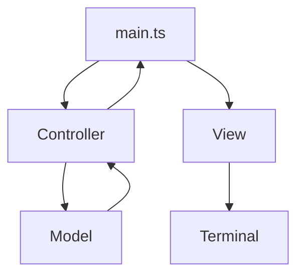
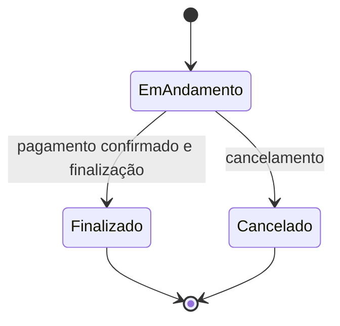

# 🐾 Exercício guiado: PetShop e Clínica Veterinária 4Patas

**Programação Orientada a Objetos com TypeScript | MVC**

**Professor: Éder Silva**

## 1. Apresentação do trabalho

Pessoal, neste exercício eu vou orientar vocês na construção de um sistema completo de atendimento para um PetShop e uma clínica veterinária. Vamos começar com uma pasta vazia e avançar até a execução e os testes do sistema.

Quero que vocês entendam o papel de cada arquivo antes de seguir para o próximo. Digitem ou reproduzam os códigos nos arquivos indicados, salvem as alterações e observem como as classes se relacionam. Não basta executar o programa: vocês precisam conseguir explicar seu funcionamento.

Ao final, teremos os cadastros de cliente, animal, veterinário e serviço, além da realização, finalização e cancelamento de atendimentos. Também vamos implementar os quatro desafios extras e o desafio de pagamento.

### O que vamos praticar

* Classes, objetos, construtores, atributos e métodos.
* Encapsulamento, associação e composição.
* Importação e exportação de classes.
* MVC, validações, cálculos e regras de negócio.
* Compilação com TypeScript e execução com Node.js.
* Testes automatizados sem bibliotecas adicionais.

### Restrições

Neste exercício não vamos utilizar arrays no código da aplicação, menus, entrada de dados pelo terminal, readline-sync, banco de dados ou arquivos JSON para armazenar cadastros. Os arquivos JSON de configuração do projeto são necessários e não representam armazenamento dos dados do sistema.

Os dados existirão somente em memória durante a execução. O Controller manterá um objeto de cada tipo, sem histórico de atendimentos.

## 2. Preparação do ambiente

Primeiro, instalem o [Node.js](https://nodejs.org/) (recomendo a versão 22 LTS ou compatível) e o [Visual Studio Code](https://code.visualstudio.com/).

No terminal do VS Code, verifiquem as instalações:

```bash
node -v
npm -v
```

Se os dois comandos exibirem números de versão, podemos continuar. Caso algum não seja reconhecido, confiram a instalação e reabram o VS Code.

## 3. Criação da estrutura

Criem uma pasta chamada `PetShopVet4Patas` e abram essa pasta no VS Code pelo menu Arquivo > Abrir Pasta. No explorador do VS Code, criem as pastas e os arquivos abaixo. Prestem atenção às letras maiúsculas e minúsculas.

```text
PetShopVet4Patas/
├── src/
│   ├── model/
│   │   ├── Cliente.ts
│   │   ├── Animal.ts
│   │   ├── Veterinario.ts
│   │   ├── Servico.ts
│   │   ├── Pagamento.ts
│   │   └── Atendimento.ts
│   ├── controller/
│   │   └── AtendimentoController.ts
│   ├── view/
│   │   └── AtendimentoView.ts
│   ├── main.ts
│   └── testes.ts
├── package.json
├── tsconfig.json
├── .gitignore
└── README.md
```

Eu vou trabalhar com três responsabilidades: Model representa os dados e as regras dos objetos; Controller coordena as operações e valida os pré-requisitos; View apresenta os resultados no terminal. O `main.ts` cria o Controller e a View e coordena a demonstração.



## 4. Configuração do projeto

Na raiz, criem o arquivo `package.json`. Não precisamos executar `npm init`, pois vou fornecer a configuração completa.

### Arquivo `package.json`

```json
{"name":"petshopvet4patas",
"version":"1.0.0",
"private":true,
"scripts":{"build":"tsc","start":"node dist/main.js","dev":"npm run build && npm start","test":"npm run build && node dist/testes.js"},
"devDependencies":{"typescript":"5.8.3"}}
```

Observem os scripts: `build` chama o compilador `tsc`, `start` executa o JavaScript gerado, `dev` combina compilação e execução e `test` compila e executa nossos testes. Fixei a versão do TypeScript em 5.8.3 para reproduzir o projeto anterior.

Agora configurem o compilador.

### Arquivo `tsconfig.json`

```json
{"compilerOptions":{"target":"ES2020",
"module":"CommonJS",
"rootDir":"src",
"outDir":"dist",
"strict":true,
"noEmitOnError":true,
"forceConsistentCasingInFileNames":true},
"include":["src/**/*.ts"]}
```

O `target` define a versão de JavaScript gerada; `module` utiliza CommonJS; `rootDir` aponta para `src` e `outDir` para `dist`. Com `strict`, o compilador verifica os tipos com maior rigor. `noEmitOnError` impede a geração de novos arquivos JavaScript quando há erros de compilação. `include` seleciona os arquivos TypeScript da pasta `src`.

Criem também o arquivo abaixo para evitar o envio das dependências e da compilação ao GitHub.

### Arquivo `.gitignore`

```text
node_modules/
dist/
```

No terminal, dentro da pasta do projeto, executem:

```bash
npm install
```

O npm criará a pasta `node_modules` e normalmente o arquivo `package-lock.json`. Não precisamos criar esses itens manualmente. Recomendo manter o arquivo de lock no repositório. A pasta `dist` será gerada na compilação.

## 5. Model: classe Cliente

Vamos começar pela classe mais simples. Ela representa o responsável pelo animal.

### Arquivo `src/model/Cliente.ts`

```typescript
export class Cliente {
    constructor(public readonly id: number, public nome: string,
        public cpf: string, public telefone: string, public email: string) {}
}
```

Eu utilizei `export` para permitir que a classe seja importada em outros arquivos. O construtor usa propriedades de parâmetro do TypeScript: ao escrever `public nome: string`, já declaramos e inicializamos o atributo. `readonly` impede a reatribuição do identificador pelo código TypeScript após a construção. CPF, telefone e email são strings, pois não são valores utilizados em cálculos. Nesta versão não validamos os dígitos do CPF.

## 6. Model: classe Animal

Agora quero relacionar o animal ao cliente, sem guardar apenas o nome ou o identificador do dono.

### Arquivo `src/model/Animal.ts`

```typescript
import { Cliente } from './Cliente';

export class Animal {
    constructor(public readonly id: number, public nome: string,
        public especie: string, public raca: string, public idade: number,
        public peso: number, public readonly dono: Cliente,
        public sexo: string = 'Não informado') {}
}
```

O `import` permite utilizar a classe Cliente. O atributo `dono` recebe um objeto Cliente completo. Essa é uma associação: o cliente pode existir independentemente do animal. O atributo `sexo`, do primeiro desafio extra, possui um valor padrão para permitir chamadas que não informem esse dado. Idade e peso são números; suas validações serão feitas no Controller.

## 7. Model: classe Veterinario

Vamos representar o profissional responsável pelo atendimento.

### Arquivo `src/model/Veterinario.ts`

```typescript
export class Veterinario {
    constructor(public readonly id: number, public nome: string,
        public crmv: string, public especialidade: string,
        public telefoneEmergencia: string = 'Não informado') {}
}
```

O CRMV é uma string para aceitar letras e números. Já incluí o telefone de emergência, conforme o segundo desafio extra. Quando não for informado, o valor padrão será utilizado. Não estamos consultando nenhum cadastro profissional externo.

## 8. Model: classe Servico

Agora vamos representar o serviço prestado e seus dados comerciais.

### Arquivo `src/model/Servico.ts`

```typescript
export class Servico {
    constructor(public readonly id: number, public readonly descricao: string,
        public readonly valor: number, public readonly duracaoMinutos: number) {}
}
```

Defini os atributos como `readonly` para que o serviço cadastrado mantenha seus dados durante o atendimento. O preço é um número e a duração é expressa em minutos. O Controller impedirá valores ou durações inválidos e descrições vazias.

## 9. Model: classe Pagamento

Antes de criar Atendimento, vou implementar o desafio final, pois Atendimento depende desta classe.

### Arquivo `src/model/Pagamento.ts`

```typescript
export class Pagamento {
    private pago = false;
    constructor(public readonly formaPagamento: string,
        public readonly valorPago: number, public readonly dataPagamento: string) {}

    confirmarPagamento(valorAtendimento: number): boolean {
        if (this.pago || !this.formaPagamento.trim() || !this.dataPagamento.trim() ||
            !Number.isFinite(this.valorPago) || !Number.isFinite(valorAtendimento) ||
            valorAtendimento <= 0 || this.valorPago < valorAtendimento) return false;
        this.pago = true;
        return true;
    }

    foiPago(): boolean { return this.pago; }
}
```

Reparem no atributo privado `pago`: não quero que outro arquivo consiga alterar diretamente a situação do pagamento. O método `confirmarPagamento` verifica se já foi pago, se forma e data estão preenchidas, se os valores são finitos e se o valor recebido é suficiente. `trim()` elimina espaços nas extremidades e `Number.isFinite()` rejeita valores como `NaN` e infinito. O método retorna `true` ou `false`; `foiPago()` consulta o estado. Este é um pagamento simulado, sem integração com banco ou PIX real.

## 10. Model: classe Atendimento

Chegamos à classe central do sistema. Vou reunir os objetos anteriores e controlar as transições do atendimento.

### Arquivo `src/model/Atendimento.ts`

```typescript
import { Cliente } from './Cliente';
import { Animal } from './Animal';
import { Veterinario } from './Veterinario';
import { Servico } from './Servico';
import { Pagamento } from './Pagamento';

export class Atendimento {
    private finalizado = false;
    private cancelado = false;
    private pagamento: Pagamento | null = null;

    constructor(public readonly id: number, public readonly cliente: Cliente,
        public readonly animal: Animal, public readonly veterinario: Veterinario,
        public readonly servico: Servico, public readonly dataAtendimento: string,
        public observacoes: string) {}

    calcularValorTotal(): number { return this.servico.valor; }
    foiFinalizado(): boolean { return this.finalizado; }
    foiCancelado(): boolean { return this.cancelado; }
    obterPagamento(): Pagamento | null { return this.pagamento; }

    registrarPagamento(forma: string, valor: number, data: string): boolean {
        if (this.finalizado || this.cancelado || this.pagamento !== null) return false;
        // O atendimento cria e possui seu próprio objeto de pagamento.
        const pagamento = new Pagamento(forma, valor, data);
        if (!pagamento.confirmarPagamento(this.calcularValorTotal())) return false;
        this.pagamento = pagamento;
        return true;
    }

    finalizar(): boolean {
        if (this.finalizado || this.cancelado || !this.pagamento?.foiPago()) return false;
        this.finalizado = true;
        return true;
    }

    cancelar(): boolean {
        if (this.cancelado || this.finalizado) return false;
        this.cancelado = true;
        return true;
    }

    consultarSituacao(): string {
        if (this.cancelado) return 'Cancelado';
        if (this.finalizado) return 'Finalizado';
        return 'Em andamento';
    }

    calcularValorComDesconto(percentual: number): number {
        if (!Number.isFinite(percentual) || percentual < 0 || percentual > 100) {
            throw new Error('Percentual deve estar entre 0 e 100.');
        }
        return Math.round(this.calcularValorTotal() * (1 - percentual / 100) * 100) / 100;
    }

    alterarObservacoes(novaObservacao: string): void {
        this.observacoes = novaObservacao;
    }
}
```

### Entendendo os métodos

| Método | Responsabilidade |
|---|---|
| `calcularValorTotal()` | Retorna o preço do serviço. |
| `foiFinalizado()` e `foiCancelado()` | Consultam os estados privados. |
| `obterPagamento()` | Retorna o pagamento ou `null`. |
| `registrarPagamento()` | Cria e confirma um pagamento válido, impedindo duplicidade e operações em atendimentos encerrados. |
| `finalizar()` | Finaliza somente se o atendimento estiver aberto e pago. |
| `cancelar()` | Cancela somente se o atendimento estiver aberto. |
| `consultarSituacao()` | Retorna Cancelado, Finalizado ou Em andamento. |
| `calcularValorComDesconto()` | Simula o preço com um percentual entre 0 e 100. |
| `alterarObservacoes()` | Substitui o texto das observações. |

Observem que `finalizado`, `cancelado` e `pagamento` são privados. Os dois estados começam em `false` e o pagamento começa em `null`. O objeto Pagamento é criado dentro de Atendimento, demonstrando composição nesta implementação. Cliente, Animal, Veterinario e Servico são recebidos pelo construtor, demonstrando associações.

O operador `?.` consulta uma propriedade ou método somente se o objeto existir. O desconto de 10% sobre R$ 150,00 resulta em R$ 135,00. A expressão com `Math.round` arredonda para duas casas decimais. Neste projeto, o desconto é apenas uma simulação, portanto o pagamento necessário continua sendo R$ 150,00. Um percentual inválido gera uma exceção.



## 11. Controller: AtendimentoController

Com os Models preparados, vamos criar a classe responsável pelas operações. Não vou utilizar `console.log()` aqui, pois a apresentação pertence à View.

### Arquivo `src/controller/AtendimentoController.ts`

```typescript
import { Cliente } from '../model/Cliente';
import { Animal } from '../model/Animal';
import { Veterinario } from '../model/Veterinario';
import { Servico } from '../model/Servico';
import { Atendimento } from '../model/Atendimento';

export class AtendimentoController {
    private cliente: Cliente | null = null;
    private animal: Animal | null = null;
    private veterinario: Veterinario | null = null;
    private servico: Servico | null = null;
    private atendimento: Atendimento | null = null;

    cadastrarCliente(id: number, nome: string, cpf: string, telefone: string, email: string): Cliente {
        this.cliente = new Cliente(id, nome, cpf, telefone, email);
        // Um novo cliente exige um novo animal associado.
        this.animal = null;
        return this.cliente;
    }

    cadastrarAnimal(id: number, nome: string, especie: string, raca: string,
        idade: number, peso: number, sexo: string = 'Não informado'): Animal | null {
        if (!this.cliente || !Number.isFinite(idade) || idade < 0 ||
            !Number.isFinite(peso) || peso <= 0) return null;
        this.animal = new Animal(id, nome, especie, raca, idade, peso, this.cliente, sexo);
        return this.animal;
    }

    cadastrarVeterinario(id: number, nome: string, crmv: string, especialidade: string,
        telefoneEmergencia: string = 'Não informado'): Veterinario {
        this.veterinario = new Veterinario(id, nome, crmv, especialidade, telefoneEmergencia);
        return this.veterinario;
    }

    cadastrarServico(id: number, descricao: string, valor: number, duracaoMinutos: number): Servico | null {
        if (!descricao.trim() || !Number.isFinite(valor) || valor <= 0 ||
            !Number.isFinite(duracaoMinutos) || duracaoMinutos <= 0) return null;
        this.servico = new Servico(id, descricao, valor, duracaoMinutos);
        return this.servico;
    }

    realizarAtendimento(id: number, dataAtendimento: string, observacoes: string): Atendimento | null {
        if (!this.cliente || !this.animal || !this.veterinario || !this.servico ||
            this.animal.dono !== this.cliente || !dataAtendimento.trim()) return null;
        if (this.atendimento && !this.atendimento.foiFinalizado() && !this.atendimento.foiCancelado()) return null;
        this.atendimento = new Atendimento(id, this.cliente, this.animal, this.veterinario,
            this.servico, dataAtendimento, observacoes);
        return this.atendimento;
    }

    registrarPagamento(forma: string, valor: number, data: string): boolean {
        return this.atendimento?.registrarPagamento(forma, valor, data) ?? false;
    }
    finalizarAtendimento(): boolean { return this.atendimento?.finalizar() ?? false; }
    cancelarAtendimento(): boolean { return this.atendimento?.cancelar() ?? false; }
    alterarObservacoes(texto: string): boolean {
        if (!this.atendimento) return false;
        this.atendimento.alterarObservacoes(texto);
        return true;
    }
    obterCliente(): Cliente | null { return this.cliente; }
    obterAnimal(): Animal | null { return this.animal; }
    obterVeterinario(): Veterinario | null { return this.veterinario; }
    obterServico(): Servico | null { return this.servico; }
    obterAtendimento(): Atendimento | null { return this.atendimento; }
}
```

### Entendendo o Controller

* Os cinco atributos privados começam com `null`, indicando que ainda não existem objetos cadastrados.
* `cadastrarCliente()` cria o cliente e limpa o animal atual, evitando associar um novo cliente ao animal anterior.
* `cadastrarAnimal()` exige um cliente, idade finita e não negativa, além de peso finito e positivo.
* `cadastrarVeterinario()` cria o profissional com os dados recebidos.
* `cadastrarServico()` rejeita descrição vazia, preço ou duração inválidos.
* `realizarAtendimento()` exige todos os objetos, verifica a associação entre animal e cliente, exige data preenchida e impede substituir um atendimento em andamento.
* `registrarPagamento()`, `finalizarAtendimento()` e `cancelarAtendimento()` delegam as regras ao Model.
* `alterarObservacoes()` encaminha a alteração ao atendimento existente.
* Os métodos `obter...()` disponibilizam os objetos atuais.

Quero que prestem atenção à união de tipos, como `Animal | null`. Ela informa que a operação pode retornar um objeto ou nenhum objeto. O operador `?? false` retorna `false` quando a chamada opcional resulta em `null` ou `undefined`. As verificações são necessárias porque o modo estrito do TypeScript não permite tratar um objeto possivelmente nulo como se ele sempre existisse.

## 12. View: AtendimentoView

Agora vamos criar a camada que mostra os dados. Ela receberá os objetos prontos, sem cadastrá-los ou decidir as regras de negócio.

### Arquivo `src/view/AtendimentoView.ts`

```typescript
import { Cliente } from '../model/Cliente';
import { Animal } from '../model/Animal';
import { Veterinario } from '../model/Veterinario';
import { Servico } from '../model/Servico';
import { Atendimento } from '../model/Atendimento';

export class AtendimentoView {
    private moeda(valor: number): string {
        return valor.toLocaleString('pt-BR', { style: 'currency', currency: 'BRL' });
    }
    private data(valor: string): string {
        if (/^\d{4}-\d{2}-\d{2}$/.test(valor)) {
            return `${valor.slice(8, 10)}/${valor.slice(5, 7)}/${valor.slice(0, 4)}`;
        }
        return valor;
    }
    private linha(): void { console.log('============================================'); }
    exibirTitulo(): void {
        this.linha();
        console.log('🐾 PETSHOP E CLÍNICA VETERINÁRIA 4Patas 🐾');
        this.linha();
    }
    exibirCliente(c: Cliente): void {
        console.log(`👤 CLIENTE #${c.id}\nNome: ${c.nome}\nCPF: ${c.cpf}\nTelefone: ${c.telefone}\nEmail: ${c.email}`);
        this.linha();
    }
    exibirAnimal(a: Animal): void {
        console.log(`🐶 ANIMAL #${a.id}\nNome: ${a.nome}\nEspécie: ${a.especie}\nRaça: ${a.raca}\nIdade: ${a.idade} anos\nPeso: ${a.peso} kg\nSexo: ${a.sexo}\nDono: ${a.dono.nome}`);
        this.linha();
    }
    exibirVeterinario(v: Veterinario): void {
        console.log(`🩺 VETERINÁRIO #${v.id}\nNome: ${v.nome}\nCRMV: ${v.crmv}\nEspecialidade: ${v.especialidade}\nEmergência: ${v.telefoneEmergencia}`);
        this.linha();
    }
    exibirServico(s: Servico): void {
        console.log(`SERVIÇO #${s.id}\nDescrição: ${s.descricao}\nValor: ${this.moeda(s.valor)}\nDuração: ${s.duracaoMinutos} minutos`);
        this.linha();
    }
    exibirAtendimento(a: Atendimento): void {
        console.log(`📋 ATENDIMENTO #${a.id}\nAnimal: ${a.animal.nome}\nCliente: ${a.cliente.nome}\nVeterinário: ${a.veterinario.nome}\nServiço: ${a.servico.descricao}\nData: ${this.data(a.dataAtendimento)}\nObservações: ${a.observacoes}\nValor total: ${this.moeda(a.calcularValorTotal())}\nSituação: ${a.consultarSituacao()}`);
        const p = a.obterPagamento();
        if (p) console.log(`Pagamento: Confirmado\nForma: ${p.formaPagamento}\nValor pago: ${this.moeda(p.valorPago)}\nData do pagamento: ${this.data(p.dataPagamento)}`);
        else console.log('Pagamento: Pendente');
        this.linha();
    }
    exibirMensagem(mensagem: string): void { console.log(mensagem); }
    exibirDesconto(valor: number): void { console.log(`Simulação com desconto: ${this.moeda(valor)}`); }
}
```

Os métodos `moeda`, `data` e `linha` são privados porque servem somente à própria View. `toLocaleString` formata os valores em reais. A expressão regular reconhece o formato AAAA-MM-DD e `slice` reorganiza os trechos para DD/MM/AAAA; isso não valida se a data existe no calendário.

Utilizei template literals (textos entre crases) com `${...}` para inserir valores e `\n` para quebrar linhas. Os métodos `exibirCliente`, `exibirAnimal`, `exibirVeterinario` e `exibirServico` apresentam os cadastros. `exibirAtendimento` apresenta os objetos associados, valor, situação e dados do pagamento, caso exista. `exibirMensagem` mostra mensagens de sucesso ou erro e `exibirDesconto` mostra a simulação.

## 13. Arquivo principal: main.ts

Finalmente vamos ligar as partes. Aqui vou demonstrar as operações com dados fictícios, sem pedir informações pelo teclado.

### Arquivo `src/main.ts`

```typescript
import { AtendimentoController } from './controller/AtendimentoController';
import { AtendimentoView } from './view/AtendimentoView';

const controller = new AtendimentoController();
const view = new AtendimentoView();
view.exibirTitulo();

const cliente = controller.cadastrarCliente(1, 'Mariana Souza', '123.456.789-00', '(51) 99999-9999', 'mariana@email.com');
const animal = controller.cadastrarAnimal(1, 'Thor', 'Cachorro', 'Golden Retriever', 4, 32.5, 'Macho');
const veterinario = controller.cadastrarVeterinario(1, 'Dra. Camila Martins', 'CRMV-RS 12345', 'Clínica Geral', '(51) 98888-8888');
const servico = controller.cadastrarServico(1, 'Consulta veterinária', 150, 40);
view.exibirCliente(cliente);
if (animal) view.exibirAnimal(animal);
view.exibirVeterinario(veterinario);
if (servico) view.exibirServico(servico);

const atendimento = controller.realizarAtendimento(1, '2026-07-22', 'Animal apresentou falta de apetite.');
if (atendimento) {
    view.exibirAtendimento(atendimento);
    view.exibirDesconto(atendimento.calcularValorComDesconto(10));
    controller.alterarObservacoes('Animal examinado. Orientações fornecidas ao responsável.');
    view.exibirMensagem(controller.finalizarAtendimento() ? 'Finalizado.' : 'Finalização sem pagamento recusada.');
    view.exibirMensagem(controller.registrarPagamento('PIX', 100, '2026-07-22') ? 'Pagamento confirmado.' : 'Pagamento insuficiente recusado.');
    view.exibirMensagem(controller.registrarPagamento('PIX', 150, '2026-07-22') ? 'Pagamento confirmado.' : 'Erro no pagamento.');
    view.exibirMensagem(controller.finalizarAtendimento() ? '✅ Atendimento finalizado.' : 'Erro na finalização.');
    view.exibirMensagem(controller.cancelarAtendimento() ? 'Cancelado.' : 'Cancelamento de atendimento finalizado recusado.');
    view.exibirAtendimento(atendimento);
} else view.exibirMensagem('Erro: atendimento não criado.');

// Novo atendimento após o encerramento do anterior, sem guardar histórico.
const segundo = controller.realizarAtendimento(2, '2026-07-23', 'Retorno agendado.');
if (segundo) {
    view.exibirMensagem(controller.cancelarAtendimento() ? '✅ Segundo atendimento cancelado.' : 'Erro no cancelamento.');
    view.exibirMensagem(controller.finalizarAtendimento() ? 'Finalizado.' : 'Finalização de atendimento cancelado recusada.');
    view.exibirAtendimento(segundo);
}
```

### Acompanhem a sequência da execução

1. Criamos o Controller e a View e exibimos o título.
2. Cadastramos Mariana, Thor, a veterinária Camila e a consulta de R$ 150,00.
3. Exibimos os cadastros. Os testes `if (animal)` e `if (servico)` evitam passar valores nulos à View.
4. Criamos o atendimento em 22/07/2026 e exibimos a situação inicial.
5. Simulamos 10% de desconto e alteramos as observações.
6. Tentamos finalizar antes de pagar. A operação deve ser recusada.
7. Tentamos pagar R$ 100,00. O pagamento deve ser recusado.
8. Pagamos R$ 150,00 e finalizamos o atendimento.
9. Tentamos cancelar o atendimento finalizado. A operação deve ser recusada.
10. Criamos um segundo atendimento, cancelamos e tentamos finalizá-lo. A finalização deve ser recusada.

O operador ternário `condicao ? mensagemSucesso : mensagemErro` escolhe qual texto enviar à View, sem transferir a regra de negócio para o arquivo principal.

## 14. Primeira compilação e execução

Salvem todos os arquivos. No terminal do VS Code, executem:

```bash
npm run dev
```

Se tudo estiver correto, veremos a saída do sistema. Também podemos separar a compilação da execução:

```bash
npm run build
npm start
```

O TypeScript gera JavaScript na pasta `dist`. Não editem os arquivos gerados: façam as alterações em `src` e compilem novamente.

### Saída esperada

Esta é a saída registrada na execução do projeto original:

```text
============================================
🐾 PETSHOP E CLÍNICA VETERINÁRIA 4Patas 🐾
============================================
👤 CLIENTE #1
Nome: Mariana Souza
CPF: 123.456.789-00
Telefone: (51) 99999-9999
Email: mariana@email.com
============================================
🐶 ANIMAL #1
Nome: Thor
Espécie: Cachorro
Raça: Golden Retriever
Idade: 4 anos
Peso: 32.5 kg
Sexo: Macho
Dono: Mariana Souza
============================================
🩺 VETERINÁRIO #1
Nome: Dra. Camila Martins
CRMV: CRMV-RS 12345
Especialidade: Clínica Geral
Emergência: (51) 98888-8888
============================================
SERVIÇO #1
Descrição: Consulta veterinária
Valor: R$ 150,00
Duração: 40 minutos
============================================
📋 ATENDIMENTO #1
Animal: Thor
Cliente: Mariana Souza
Veterinário: Dra. Camila Martins
Serviço: Consulta veterinária
Data: 22/07/2026
Observações: Animal apresentou falta de apetite.
Valor total: R$ 150,00
Situação: Em andamento
Pagamento: Pendente
============================================
Simulação com desconto: R$ 135,00
Finalização sem pagamento recusada.
Pagamento insuficiente recusado.
Pagamento confirmado.
✅ Atendimento finalizado.
Cancelamento de atendimento finalizado recusado.
📋 ATENDIMENTO #1
Animal: Thor
Cliente: Mariana Souza
Veterinário: Dra. Camila Martins
Serviço: Consulta veterinária
Data: 22/07/2026
Observações: Animal examinado. Orientações fornecidas ao responsável.
Valor total: R$ 150,00
Situação: Finalizado
Pagamento: Confirmado
Forma: PIX
Valor pago: R$ 150,00
Data do pagamento: 22/07/2026
============================================
✅ Segundo atendimento cancelado.
Finalização de atendimento cancelado recusada.
📋 ATENDIMENTO #2
Animal: Thor
Cliente: Mariana Souza
Veterinário: Dra. Camila Martins
Serviço: Consulta veterinária
Data: 23/07/2026
Observações: Retorno agendado.
Valor total: R$ 150,00
Situação: Cancelado
Pagamento: Pendente
============================================
```

## 15. Testes automatizados: testes.ts

Não quero que vocês avaliem o sistema apenas pelo que aparece na tela. Vamos escrever testes que verificam se cada regra realmente funciona. Não precisamos instalar Jest ou outra biblioteca para esta atividade.

### Arquivo `src/testes.ts`

```typescript
import { AtendimentoController } from './controller/AtendimentoController';
import { AtendimentoView } from './view/AtendimentoView';
const c = new AtendimentoController();
const view = new AtendimentoView();
let total = 0;
function verificar(condicao: boolean, nome: string): void {
    if (!condicao) throw new Error('Falhou: ' + nome);
    total++;
    view.exibirMensagem('OK: ' + nome);
}
verificar(c.cadastrarAnimal(1,'Thor','Cão','SRD',4,10) === null,'Animal sem cliente');
verificar(c.realizarAtendimento(1,'2026-07-22','') === null,'Atendimento sem cadastros');
verificar(!c.finalizarAtendimento() && !c.cancelarAtendimento(),'Sem atendimento');
c.cadastrarCliente(1,'Mariana','123','999','a@exemplo.com');
verificar(c.cadastrarAnimal(1,'Thor','Cão','SRD',4,10)?.dono === c.obterCliente(),'Associação com cliente');
c.cadastrarVeterinario(1,'Camila','123','Clínica');
verificar(c.cadastrarServico(1,'Consulta',0,30) === null,'Valor zero');
verificar(c.cadastrarServico(1,'Consulta',100,0) === null,'Duração zero');
verificar(c.cadastrarServico(1,'  ',100,30) === null,'Descrição vazia');
verificar(c.cadastrarServico(1,'Consulta',NaN,30) === null,'Valor não numérico');
c.cadastrarServico(1,'Consulta',150,40);
const a = c.realizarAtendimento(1,'2026-07-22','Inicial');
if (!a) throw new Error('Atendimento não criado');
verificar(a.consultarSituacao() === 'Em andamento' && !a.foiCancelado() && !a.foiFinalizado(),'Estado inicial');
verificar(a.calcularValorTotal() === 150 && a.calcularValorComDesconto(10) === 135,'Cálculos');
verificar(c.alterarObservacoes('Nova') && a.observacoes === 'Nova','Observações');
verificar(!c.finalizarAtendimento(),'Finalização sem pagamento');
verificar(!c.registrarPagamento('PIX',149,'2026-07-22'),'Pagamento insuficiente');
verificar(c.registrarPagamento('PIX',150,'2026-07-22'),'Pagamento válido');
verificar(!c.registrarPagamento('PIX',150,'2026-07-22'),'Pagamento duplicado');
verificar(c.finalizarAtendimento() && a.consultarSituacao() === 'Finalizado','Finalização');
verificar(!c.finalizarAtendimento() && !c.cancelarAtendimento(),'Estado finalizado protegido');
const b = c.realizarAtendimento(2,'2026-07-23','');
if (!b) throw new Error('Segundo atendimento não criado');
verificar(c.cancelarAtendimento() && b.consultarSituacao() === 'Cancelado','Cancelamento');
verificar(!c.cancelarAtendimento() && !c.finalizarAtendimento() && !c.registrarPagamento('PIX',150,'2026-07-23'),'Estado cancelado protegido');
view.exibirMensagem(`Total: ${total} testes aprovados.`);
```

A função `verificar` recebe uma condição booleana e o nome do teste. Quando a condição for falsa, `throw new Error` interrompe a execução. Quando for verdadeira, incrementamos o contador e exibimos a confirmação. Os testes são executados em sequência e utilizam objetos em memória, sem arrays.

Executem:

```bash
npm test
```

Ao final, esperamos a mensagem `Total: 19 testes aprovados.`. Se houver falha, leiam o nome da regra exibida, localizem o método correspondente e confiram o código.

## 16. Documentação do repositório

Para concluir, criem o `README.md` na raiz. Vou manter abaixo o conteúdo do README do projeto original. Copiem apenas o conteúdo dentro do bloco externo de quatro crases, preservando as três crases internas, que formatam os exemplos de código no GitHub.

````markdown
# 🐾 PetShopVet4Patas

Projeto didático de Programação Orientada a Objetos com TypeScript e MVC simplificado.

## 1. Requisitos

Instale Node.js (versão 22 recomendada, com npm) e Visual Studio Code. Não é necessário banco de dados, extensão específica nem instalação global do TypeScript.

## 2. Executar no VS Code

1. Extraia o ZIP.
2. Abra a pasta PetShopVet4Patas no VS Code (Arquivo > Abrir Pasta).
3. Abra Terminal > Novo Terminal. Confirme que está na pasta que contém package.json.
4. Execute os comandos abaixo, um de cada vez:

```bash
node -v
npm -v
npm install
npm run dev
```

O último comando compila e executa a aplicação. A instalação inicial requer acesso ao registro npm.

Também é possível executar separadamente:

```bash
npm run build
npm start
```

O JavaScript compilado fica em dist/. Não edite esses arquivos: edite os arquivos TypeScript em src/ e compile novamente.

## 3. Estrutura

```text
PetShopVet4Patas/
  src/
    model/
      Cliente.ts
      Animal.ts
      Veterinario.ts
      Servico.ts
      Atendimento.ts
      Pagamento.ts
    controller/
      AtendimentoController.ts
    view/
      AtendimentoView.ts
    main.ts
    testes.ts
  package.json
  tsconfig.json
  .gitignore
  README.md
```

Model representa os dados e estados do atendimento. Controller cria e valida objetos, mantém uma referência de cada tipo e encaminha ações. View apresenta os resultados no terminal. main.ts organiza a demonstração e testes.ts verifica regras automaticamente.

## 4. Como usar

Não existe menu nem entrada interativa. Altere os argumentos das chamadas em src/main.ts para cadastrar outros clientes, animais, profissionais e serviços. Execute npm run dev novamente.

A demonstração usa Mariana, Thor, Dra. Camila e uma consulta de R$ 150. Primeiro apresenta o atendimento em andamento; simula desconto de 10% (R$ 135), altera observações, recusa finalização sem pagamento, recusa pagamento de R$ 100, confirma PIX de R$ 150 e finaliza. Em seguida demonstra a recusa de cancelamento de atendimento finalizado e cria um segundo atendimento para demonstrar cancelamento.

Para alterar dados:

```typescript
controller.cadastrarCliente(1, 'Ana', '123', '99999', 'ana@exemplo.com');
controller.cadastrarAnimal(1, 'Luna', 'Gato', 'SRD', 2, 4.5, 'Fêmea');
controller.cadastrarVeterinario(1, 'Dr. Pedro', 'CRMV-RS 123', 'Clínica Geral', '99999');
controller.cadastrarServico(1, 'Vacinação', 90, 20);
const atendimento = controller.realizarAtendimento(1, '2026-07-22', 'Vacina de rotina');
if (atendimento) {
    controller.registrarPagamento('PIX', 90, '2026-07-22');
    controller.finalizarAtendimento();
    view.exibirAtendimento(atendimento);
}
```

Substitua a sequência de demonstração existente por esse exemplo, mantendo a criação do controller e da view.

## 5. Testes

```bash
npm test
```

Executa 19 verificações, incluindo cadastros inválidos, associação, cálculo, pagamento e transições de estado. Uma falha gera um erro e interrompe a execução.

## 6. Decisões de implementação

* Todos os quatro desafios extras e o desafio final foram incorporados. A regra final exige pagamento antes da finalização.
* O desconto é apenas uma simulação, não altera o valor original nem o mínimo exigido para pagamento.
* Um pagamento é criado dentro do atendimento (composição) e guardado somente se confirmado. Cancelar atendimento pago, mas ainda não finalizado, é permitido conforme o enunciado; não existe estorno automático.
* Um novo atendimento só substitui o anterior se ele estiver encerrado. Um novo cliente limpa a referência do animal atual, para preservar a associação correta. Cadastros inválidos não substituem cadastros válidos anteriores.
* Idade e peso recebem validação numérica adicional. CPF, CRMV, telefone e email são textos demonstrativos, sem validação documental; datas são strings, sem validação completa de calendário. Os dados são fictícios.
* Não há arrays no código da aplicação, menus, readline-sync, banco de dados ou armazenamento JSON. package.json e tsconfig.json são arquivos obrigatórios de configuração, não arquivos de dados.
* Os dados existem somente em memória; não há histórico, integração financeira ou persistência. O pagamento é simulado, sem transação real.

## 7. Solução de problemas

Se npm não for reconhecido, instale Node.js e reabra o VS Code. Se o TypeScript não for encontrado, execute npm install. Se npm.ps1 for bloqueado no PowerShell, use o perfil Prompt de Comando do terminal do VS Code ou execute npm.cmd em vez de npm. Se dist/main.js não existir, execute npm run build antes de npm start.
````

## 17. Exercícios de fixação

Depois de executar a versão original e conferir os 19 testes, quero que vocês experimentem as seguintes alterações temporárias no `main.ts`. Façam uma alteração de cada vez, executem o sistema e depois restaurem o código original.

1. Troquem o nome, a espécie e o peso do animal por dados fictícios diferentes.
2. Tentem cadastrar um animal antes do cliente e expliquem por que recebem `null`.
3. Informem um preço igual a zero no cadastro do serviço e observem o resultado.
4. Simulem um desconto de 20% em um serviço de R$ 150,00. Qual será o resultado? Esse desconto altera a cobrança?
5. Tentem registrar um pagamento inferior ao valor do serviço e depois um pagamento suficiente.
6. Tentem finalizar duas vezes o mesmo atendimento.
7. Expliquem a diferença entre associação de Cliente com Animal e composição de Atendimento com Pagamento.
8. Expliquem por que o Controller não deve usar `console.log()` e por que a View não deve cadastrar objetos.

## 18. Solução de problemas

| Problema | O que eu recomendo verificar |
|---|---|
| `npm` não reconhecido | Instalação do Node.js e abertura de um novo terminal. |
| `Cannot find module` | Nome dos arquivos, caminho dos imports e pastas corretas. |
| Erro ao executar `npm install` | Conexão com a internet, permissões e presença do package.json. |
| Erro de tipo envolvendo `null` | Conferir as verificações antes de acessar objetos opcionais. |
| `dist/main.js` não encontrado | Executar `npm run build` e corrigir erros de compilação antes de iniciar. |
| Teste com falha | Ler a mensagem e conferir a regra correspondente no Model ou Controller. |

## 19. Checklist de entrega

- [ ] Criei todos os arquivos nas pastas indicadas.
- [ ] Instalei as dependências e compilei sem erros.
- [ ] Compreendi os construtores, imports e os relacionamentos entre objetos.
- [ ] Executei o sistema e conferi as mensagens da View.
- [ ] Verifiquei o pagamento, a finalização e o cancelamento.
- [ ] Executei os 19 testes automatizados.
- [ ] Mantive as regras de negócio nos Models e as validações e operações no Controller.
- [ ] Não utilizei arrays na aplicação, menu, banco de dados ou entrada interativa.
- [ ] Documentei o projeto e mantive o `.gitignore`.

## 20. Limites desta versão

Quero que vocês entendam que estamos construindo um projeto didático. Não temos persistência de dados, validação documental de CPF ou CRMV, validação completa de calendário, estorno automático nem integração financeira. O código original permite alterar observações mesmo após o encerramento e cancelar um atendimento pago que ainda não tenha sido finalizado. Não existe regra de devolução do pagamento. O desconto não altera a cobrança. Mantive essas decisões para preservar exatamente a implementação original; elas podem ser discutidas em uma evolução futura.

Pessoal, ao concluir este exercício, vocês terão construído um sistema que reúne os principais conceitos estudados em Programação Orientada a Objetos. Quero que consigam explicar cada decisão, e não somente reproduzir o código. A organização e a compreensão das responsabilidades são tão importantes quanto o resultado no terminal.

**Boa programação! 🐾💻**

**Prof. Éder Silva**
