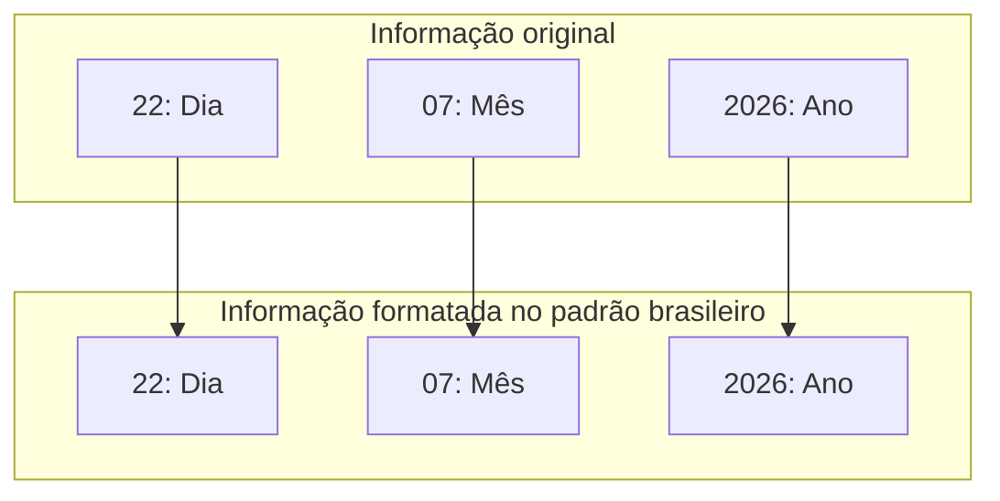
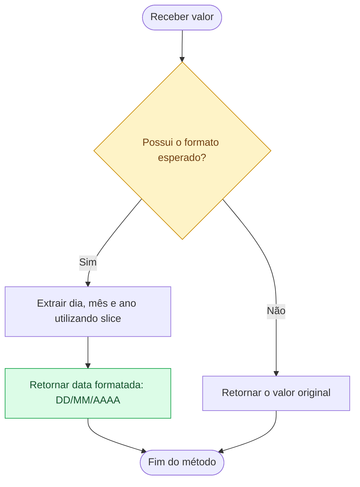

# 📅 Formatação de datas em TypeScript

Esse método tem como objetivo **formatar uma data do padrão internacional para o padrão brasileiro**, facilitando a apresentação das informações no terminal.

Por exemplo, o sistema recebe a data no formato `2026-07-22` e apresenta `22/07/2026`.

Vamos analisar detalhadamente cada parte do código.

## 1. Código completo

```typescript
private data(valor: string): string {
    if (/^\d{4}-\d{2}-\d{2}$/.test(valor)) {
        return `${valor.slice(8, 10)}/${valor.slice(5, 7)}/${valor.slice(0, 4)}`;
    }
    return valor;
}
```

## 2. Declaração do método

```typescript
private data(valor: string): string {
```

| Elemento | Significado |
|---|---|
| `private` | Define que o método somente pode ser acessado dentro da própria classe. |
| `data` | Nome do método. |
| `valor` | Parâmetro que receberá a data. |
| `valor: string` | Define que o parâmetro deve ser uma informação textual. |
| `: string` | Define que o método retornará uma informação textual. |

No nosso sistema PetShopVet4Patas, esse método pertence à classe `AtendimentoView`, pois sua responsabilidade é formatar a informação para apresentação, sem modificar os dados originais do atendimento.

## 3. Verificando o formato da data

```typescript
if (/^\d{4}-\d{2}-\d{2}$/.test(valor)) {
```

Aqui estamos utilizando uma **expressão regular**, também conhecida como RegEx (Regular Expression).

Uma expressão regular permite identificar padrões dentro de um texto.

Neste caso, queremos verificar se a informação recebida possui exatamente o seguinte formato:

| Ano | Separador | Mês | Separador | Dia |
|:---:|:---:|:---:|:---:|:---:|
| **2026** | `-` | **07** | `-` | **22** |

Quatro dígitos, separador, dois dígitos, separador e dois dígitos.

### Entendendo a expressão regular

```typescript
/^\d{4}-\d{2}-\d{2}$/
```

| Símbolo | Significado |
|---|---|
| `/` | Delimita o início e o final da expressão regular. |
| `^` | Representa o início do texto. |
| `\d` | Representa um dígito numérico de 0 a 9. |
| `{4}` | Exige exatamente quatro ocorrências. |
| `-` | Exige a presença literal do hífen. |
| `\d{2}` | Exige exatamente dois dígitos numéricos. |
| `$` | Representa o final do texto. |

### O método test()

```typescript
.test(valor)
```

O método `test()` verifica se o conteúdo da variável corresponde ao padrão definido pela expressão regular.

Ele retorna um valor booleano:

| Valor recebido | Retorno |
|---|---|
| `2026-07-22` | `true` |
| `2026-12-25` | `true` |
| `22/07/2026` | `false` |
| `2026-7-22` | `false` |
| `Olá Mundo` | `false` |
| `2026-07-22ABC` | `false` |

Se o resultado for `true`, o programa executará as instruções dentro do `if`.

## 4. Entendendo o método slice()

```typescript
valor.slice(8, 10)
```

O método `slice()` permite extrair uma parte de uma string.

Sua sintaxe é:

```typescript
string.slice(inicio, fim)
```

O primeiro parâmetro representa a posição inicial, que será incluída. O segundo representa a posição final, que não será incluída.

É importante lembrar que, na programação, os índices de uma string começam em zero.

### Visualizando as posições

Considerando a seguinte data:

```typescript
const valor = "2026-07-22";
```

| Índice | 0 | 1 | 2 | 3 | 4 | 5 | 6 | 7 | 8 | 9 |
|---|---|---|---|---|---|---|---|---|---|---|
| Caractere | 2 | 0 | 2 | 6 | `-` | 0 | 7 | `-` | 2 | 2 |

| Parte | Método | Resultado |
|---|---|---|
| Ano | `slice(0, 4)` | `2026` |
| Mês | `slice(5, 7)` | `07` |
| Dia | `slice(8, 10)` | `22` |

### Extraindo o dia

```typescript
valor.slice(8, 10)
```

Captura os caracteres das posições 8 e 9.

Resultado:

```text
22
```

### Extraindo o mês

```typescript
valor.slice(5, 7)
```

Captura os caracteres das posições 5 e 6.

Resultado:

```text
07
```

### Extraindo o ano

```typescript
valor.slice(0, 4)
```

Captura os caracteres das posições 0, 1, 2 e 3.

Resultado:

```text
2026
```

## 5. Entendendo o Template Literal

```typescript
return `${valor.slice(8, 10)}/${valor.slice(5, 7)}/${valor.slice(0, 4)}`;
```

Aqui estamos utilizando um recurso chamado **Template Literal**, que permite inserir variáveis e expressões diretamente dentro de uma string.

Utilizamos crases para delimitar o texto e `${}` para executar expressões dentro dele.

O programa extrai o dia, o mês e o ano, reorganizando essas informações e acrescentando as barras como separadores.



**Resultado:** `22/07/2026`

## 6. Entendendo o último return

```typescript
return valor;
```

Caso a informação recebida não corresponda ao padrão esperado pela expressão regular, o método simplesmente retorna o conteúdo original.

Dessa maneira, o programa evita tentar reorganizar uma informação que possui um formato diferente.

Por exemplo, se receber `22/07/2026`, retornará `22/07/2026` sem realizar nenhuma alteração.

## 7. Teste interativo do método

Você pode simular exatamente o funcionamento do código original. Altere a informação e observe o resultado da expressão regular e da formatação.

Como o GitHub não executa controles interativos diretamente em arquivos Markdown, utilize o código abaixo em um arquivo `testeData.ts` no VS Code.

```typescript
const valor = "2026-07-22";
const valido = /^\d{4}-\d{2}-\d{2}$/.test(valor);
const resultado = valido
    ? `${valor.slice(8, 10)}/${valor.slice(5, 7)}/${valor.slice(0, 4)}`
    : valor;

console.log(`Valor recebido pelo método: ${valor}`);
console.log(`Resultado do test(): ${valido}`);

if (valido) {
    console.log(`Dia: ${valor.slice(8, 10)}`);
    console.log(`Mês: ${valor.slice(5, 7)}`);
    console.log(`Ano: ${valor.slice(0, 4)}`);
} else {
    console.log("O formato não corresponde ao padrão. O método executará o último return.");
}

console.log(`Resultado retornado pelo método: ${resultado}`);
```

Em um projeto com TypeScript instalado, execute:

```bash
npx tsc testeData.ts
node testeData.js
```

Experimente substituir o valor da variável pelos exemplos abaixo e executar novamente.

| Valor recebido | Resultado do test() | Resultado retornado |
|---|---|---|
| `2026-07-22` | `true` | `22/07/2026` |
| `2026-12-25` | `true` | `25/12/2026` |
| `25/12/2026` | `false` | `25/12/2026` |
| `2026-99-99` | `true` | `99/99/2026` |
| `Olá Mundo` | `false` | `Olá Mundo` |

## 8. Uma versão mais didática do mesmo código

Para os alunos que estão começando a aprender TypeScript, podemos separar as operações em variáveis. Isso facilita a leitura e a compreensão do método.

```typescript
private data(valor: string): string {

    // Verifica se a data possui o formato esperado
    if (/^\d{4}-\d{2}-\d{2}$/.test(valor)) {

        // Extrai o dia
        const dia = valor.slice(8, 10);

        // Extrai o mês
        const mes = valor.slice(5, 7);

        // Extrai o ano
        const ano = valor.slice(0, 4);

        // Retorna a data no formato brasileiro
        return `${dia}/${mes}/${ano}`;
    }

    // Retorna a informação original
    return valor;
}
```

Essa versão possui exatamente o mesmo comportamento do código original. A única diferença é que as operações foram separadas para facilitar o aprendizado.

## 9. Fluxograma do método



## 10. Atenção: verificar o formato não significa validar a data

A expressão regular utilizada verifica somente a estrutura textual da informação, não sua validade no calendário.

Por exemplo:

| Entrada | Saída | Data real válida? |
|---|---|---|
| `2026-07-22` | 22/07/2026 | Sim |
| `2026-12-25` | 25/12/2026 | Sim |
| `2026-99-99` | 99/99/2026 | Não |
| `2026-02-31` | 31/02/2026 | Não |
| `2026-13-10` | 10/13/2026 | Não |

Todas essas entradas passam pela expressão regular, pois possuem a quantidade correta de dígitos e separadores.

Essa é uma limitação intencional do método original, cuja responsabilidade é apenas formatar a apresentação da informação.

## 11. Por que esse método está na View?

Dentro da arquitetura MVC, é importante separar as responsabilidades.

| Camada | Responsabilidade relacionada à data |
|---|---|
| Model | Armazenar a data do atendimento. |
| Controller | Controlar o recebimento e a validação dos dados, quando implementada. |
| View | Formatar e apresentar a data ao usuário. |

Na classe `AtendimentoView`, podemos utilizar o método da seguinte maneira:

```typescript
console.log(
    `Data: ${this.data(atendimento.dataAtendimento)}`
);
```

A informação original continua armazenada no objeto `Atendimento`. Apenas sua representação visual é modificada.

**Esse pequeno método é um excelente exemplo didático**, pois trabalha simultaneamente com encapsulamento, métodos privados, parâmetros, tipos de retorno, estruturas condicionais, expressões regulares, manipulação de strings, Template Literals e separação de responsabilidades dentro do MVC.
